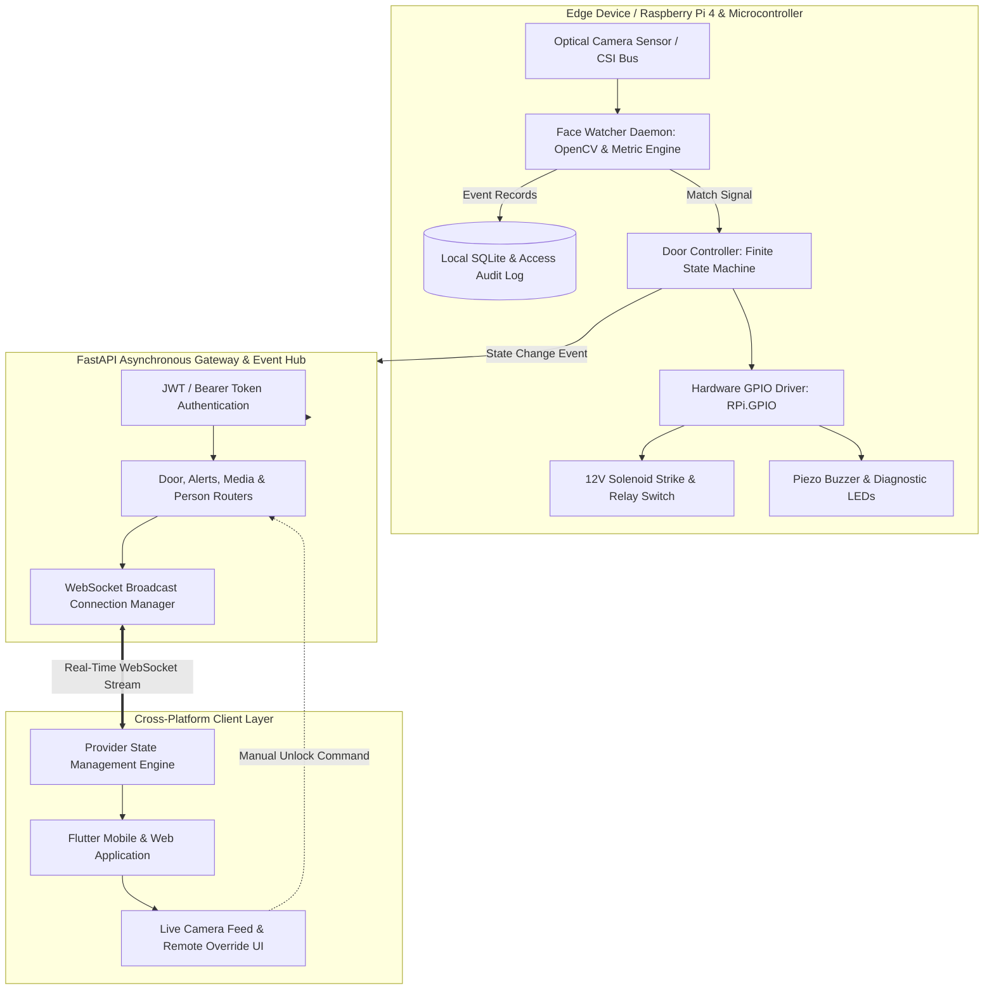

# Embedded Systems & IoT Hub

<div align="center">

[](https://flutter.dev/)
[](https://dart.dev/)
[](https://fastapi.tiangolo.com/)
[](https://developer.mozilla.org/en-US/docs/Web/API/WebSockets_API)
[](https://python.org/)
[](https://opensource.org/licenses/MIT)

**Edge computing daemons, hardware abstraction layers, biometric actuation, and real-time telemetry.**

[Architecture](#-system-architecture) •
[Submodule Catalog](#-submodule-ecosystem) •
[Physical & Mathematical Models](#-mathematical--computational-formulations) •
[Hardware Pinouts & Circuit Specs](#-hardware-pinout--actuator-specifications) •
[Demonstrations](#-embedded--hardware-demonstrations) •
[Quickstart](#-build--submodule-initialization) •
[Citations](#-references--academic-citations)

</div>

---

## 🔌 Overview

The **Embedded Systems & IoT Hub** bridges physical electronic hardware with real-time distributed microservices. It focuses on low-latency edge computing, biometric access control, hardware interrupt management, and bi-directional WebSocket telemetry.

Using **Git Submodules**, this repository encapsulates complete hardware controllers and cross-platform companion clients while maintaining isolated development lifecycles.

---

## 🏗️ System Architecture

The edge IoT architecture decouples physical actuator drivers from user-facing clients using asynchronous message brokers and hardware abstraction daemons:



---

## 📦 Submodule Ecosystem

This hub organizes the following specialized repositories located in `submodules/`:

| Directory | Upstream Repository | Language | Core Technical Focus |
| :--- | :--- | :--- | :--- |
| `submodules/smart-door-system` | [`Neo-0013/smart-door-system`](https://github.com/Neo-0013/smart-door-system) | Dart / Python | Biometric access control system featuring Flutter dashboard, FastAPI async daemon, OpenCV face watcher, and GPIO relay automation. |

### Directory Hierarchy
```text
embedded-iot-hub/
├── .gitmodules
├── README.md
└── submodules/
    └── smart-door-system/
        ├── backend/
        │   ├── main.py                    # FastAPI ASGI application & lifecycle hooks
        │   ├── auth.py                    # PBKDF2 hashing & JWT authorization
        │   ├── database.py                # SQLAlchemy ORM engine & SQLite persistence
        │   ├── models.py                  # Access logs, registered faces & alert schemas
        │   ├── websocket_manager.py       # Active socket pool & broadcast dispatcher
        │   ├── simulate_camera.py         # Virtual camera generator for headless testbeds
        │   ├── face_recognition_module/
        │   │   ├── door_controller.py     # GPIO solenoid state machine & relay pins
        │   │   └── face_watcher.py        # OpenCV frame sampler & metric comparator
        │   └── routers/                   # Modular REST endpoints (door, media, alerts)
        └── smart_door_app/                # Flutter Cross-Platform Client
            ├── lib/
            │   ├── main.dart              # Flutter application entry & multi-provider init
            │   ├── providers/             # State managers: Auth, DoorStatus & CameraStream
            │   ├── screens/               # Dashboard, Face Enrollment & Audit History
            │   ├── services/              # REST Client & WebSocket subscription client
            │   └── widgets/               # Custom unlock buttons, live video preview
            └── pubspec.yaml               # Flutter dependencies & platform targets
```

---

## 🔬 Mathematical & Computational Formulations

### 1. Discrete Digital Filtering for Environmental Sensors
To reject mechanical switch contact chatter and optical sensor noise, raw inputs are conditioned using a Discrete First-Order Exponential Low-Pass Filter:

$$y_k = \alpha x_k + (1 - \alpha) y_{k-1}$$

$$\alpha = \frac{\Delta t}{\tau + \Delta t}$$

where $\Delta t$ is the sampling interval and $\tau$ is the system time constant. For Gaussian measurement noise $z_k$, state estimation follows the Discrete Kalman Filter:

$$\mathbf{K}_k = \mathbf{P}_k^- \mathbf{H}^T \left(\mathbf{H} \mathbf{P}_k^- \mathbf{H}^T + \mathbf{R}\right)^{-1}$$

$$\hat{\mathbf{x}}_k = \hat{\mathbf{x}}_k^- + \mathbf{K}_k \left(\mathbf{z}_k - \mathbf{H} \hat{\mathbf{x}}_k^-\right)$$

### 2. Edge IoT Power Budgeting & Battery Life Estimation
For autonomous or battery-backed edge hardware, total power consumption depends on the operating duty cycle:

$$P_{\text{avg}} = \frac{T_{\text{active}} P_{\text{active}} + T_{\text{sleep}} P_{\text{sleep}}}{T_{\text{cycle}}}$$

Given nominal battery capacity $C_{\text{Ah}}$ and operating voltage $V_{\text{nominal}}$:

$$E_{\text{total}} = V_{\text{nominal}} \cdot C_{\text{Ah}} \cdot 3600 \quad \text{[Joules]}$$

$$\text{Lifespan}_{\text{hours}} = \frac{V_{\text{nominal}} \cdot C_{\text{Ah}} \cdot \eta_{\text{conv}}}{P_{\text{avg}}}$$

where $\eta_{\text{conv}} \approx 0.88$ represents DC-DC buck converter efficiency.

### 3. Truncated Binary Exponential Backoff with Jitter
Resilient edge reconnect logic in network-constrained environments avoids synchronized thundering herd problems on WebSocket reconnect:

$$t_{\text{backoff}}(c) = \min\left(t_{\max}, \; t_0 \cdot 2^{\min(c, c_{\max})}\right) + \mathcal{U}(0, \delta)$$

where $c$ is the consecutive disconnect count, $t_0 = 500\text{ ms}$, and $\mathcal{U}(0, \delta)$ is uniform pseudorandom jitter.

---

## ⚡ Hardware Pinout & Actuator Specifications

| Peripheral Component | Microcontroller / RPi Pin | Electrical Characteristics | Protection & Driving Circuit |
| :--- | :--- | :--- | :--- |
| **12V Solenoid Door Strike** | GPIO 17 (WiringPi 0) | 12V DC, 800 mA continuous | Optocoupled 5V Relay + 1N4007 Flyback Diode |
| **Status Indicator (Green)** | GPIO 27 (WiringPi 2) | 3.3V Logic, 15 mA | $220\ \Omega$ Current-limiting resistor |
| **Warning Indicator (Red)**  | GPIO 22 (WiringPi 3) | 3.3V Logic, 15 mA | $220\ \Omega$ Current-limiting resistor |
| **Piezo Audio Buzzer**       | GPIO 18 (PWM0) | 3.3V PWM, 4 kHz resonance | 2N2222 NPN Transistor Driver |
| **Optical Video Ingestion**  | 15-pin CSI-2 Ribbon Port | 1080p @ 30 FPS, MIPI CSI | Integrated hardware ISP pipeline |

---

## 🎬 Embedded & Hardware Demonstrations

<div align="center">

| Edge Hardware Controller & Daemon | Flutter Mobile & Web Client Dashboard |
| :---: | :---: |
|  |  |
| *12V Solenoid strike relay actuation with optical telemetry* | *Real-time WebSocket door state & camera feed* |

</div>

---

## 🚀 Build & Submodule Initialization

### 1. Clone Hub with Submodules
```bash
git clone --recurse-submodules https://github.com/Neo-0013/embedded-iot-hub.git
cd embedded-iot-hub
```

### 2. Start Edge Daemon Backend
```bash
cd submodules/smart-door-system/backend
python3 -m venv venv
source venv/bin/activate
pip install -r requirements.txt
cp .env.example .env

# Run server with real or simulated camera:
uvicorn main:app --host 0.0.0.0 --port 8000 --reload
```

### 3. Launch Flutter Client App
```bash
cd ../smart_door_app
flutter pub get
flutter run -d chrome # or flutter run -d android
```

---

## 📚 References & Academic Citations

1. **Al-Fuqaha, A., et al.** (2015). *Internet of Things: A survey on enabling technologies, protocols, and applications*. IEEE Communications Surveys & Tutorials.
2. **Kalman, R. E.** (1960). *A New Approach to Linear Filtering and Prediction Problems*. Journal of Basic Engineering.
3. **Tiangolo, S.** (2019). *FastAPI: Modern, fast (high-performance), web framework for building APIs with Python 3.8+*.
4. **Google LLC**. (2020). *Flutter: Build apps for any screen*.

---

<div align="center">
<sub>Embedded Systems & IoT Hub • Curated by <a href="https://github.com/Neo-0013">Neo-0013</a> • Released under the MIT License</sub>
</div>
